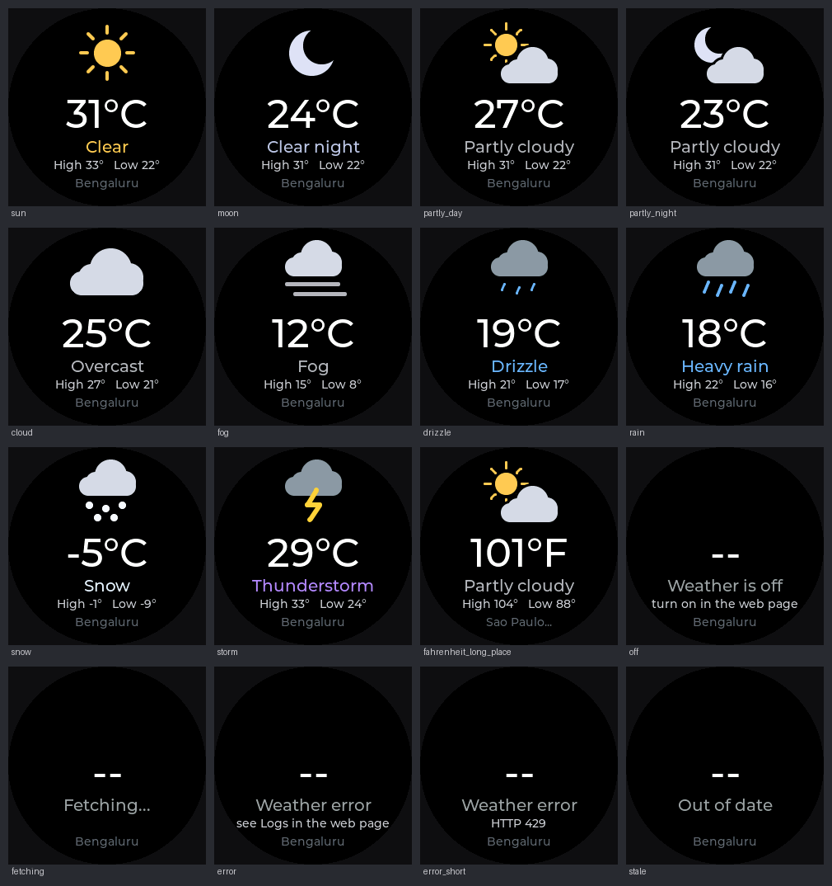

# Desk Buddy

A tiny desk companion for the **Elecrow CrowPanel 1.28" ESP32-S3 round display** (240x240, touch, rotary knob, 5 RGB LEDs).

- **Buddy** - on standby it is a pair of animated eyes that blink, look around, get sleepy at night, surprised before a meeting and grumpy when your Mac is working hard.
- **Tap for the clock** - one tap shows the time, the date, the weather and your next meeting, then it goes back to being a buddy.
- **Shortcut keys** - it is a Bluetooth keyboard: Spotlight, screenshots, lock screen, mute in Meet / Zoom / Teams, media keys, any combination you define. Buttons can also **launch apps and run automations** on your Mac through a small helper.
- **Google Calendar** - upcoming meetings, a warning 10 minutes before and when one starts.
- **Timers** - presets (Focus 25, Break 5, ...) or dial any time with the knob; the LED ring shows progress, and the Mac gets a notification when it ends.
- **Web editor** at `http://buddy.local` - edit the shortcut pages, timer presets and settings from your browser; update the firmware over WiFi.

Built for **macOS**. The buddy shows up as a normal Bluetooth keyboard (so shortcuts use the Command key), and the helper uses `open`, `osascript` and the Shortcuts app.

> **Status: read this first.** The firmware compiles with the ESP32-S3 toolchain and all the logic that can be tested without hardware is tested, but **it has not been run on a real board yet**. See [What has and has not been verified](#what-has-and-has-not-been-verified). The first-boot checklist is milestone M0 in [docs/BACKLOG.md](docs/BACKLOG.md).

## What you need

- The CrowPanel 1.28" ESP32-S3 display and a **USB-C data cable** (some cables only charge)
- A Mac with macOS 12 or newer (macOS 12 is needed only for the "run a Shortcut" action)
- [PlatformIO](https://platformio.org) - the VS Code extension, or `brew install platformio`
- [Node.js](https://nodejs.org) 18 or newer for the Mac helper - `brew install node`
- 2.4 GHz WiFi (the ESP32 does not do 5 GHz) and a Google account for the calendar

## Quick start

### 1. Build and flash

```sh
git clone <your repository> desk-buddy && cd desk-buddy
pio run -t upload      # firmware, over USB-C
pio run -t uploadfs    # the web editor pages (./data)
```

The eyes should appear. If the board is not found, try another cable or port; if your board has a BOOT button, hold it while plugging in USB and upload again. Your settings and shortcuts live in a separate flash area, so re-running `uploadfs` never wipes them.

### 2. Connect it to WiFi (first boot)

The screen shows the setup instructions by itself:

1. On your phone or Mac join the WiFi **CrowPanel-Buddy** with the **password shown on the buddy's screen** (it is random on every boot).
2. A setup page opens (or go to `http://192.168.4.1`). Pick your home WiFi, type its password, choose an **admin password** for the buddy (6+ characters) and save.
3. The buddy restarts and joins your WiFi. Open **http://buddy.local** on your Mac. The user name is `admin` and the password is the one you just chose. (If `buddy.local` does not open, long-press the knob: the settings screen shows the IP address.)

### 3. Pair it with your Mac

System Settings -> Bluetooth -> **CrowPanel Buddy** -> Connect. macOS may open *Keyboard Setup Assistant*; close it, or if letters come out wrong choose the ANSI layout. Then open the shortcut screen on the buddy (swipe left from the clock) and press a button - for example **Spot** opens Spotlight.

On the buddy's status screen the Bluetooth line reads `BT pair` until a Mac connects, `BT ok` once connected, and `BT off` only if you switched the keyboard off in Settings.

The pairing is remembered, so after a power cycle the Mac should reconnect by itself within a few seconds. If you paired with an older firmware, remove *CrowPanel Buddy* from System Settings -> Bluetooth **once** after flashing this one and pair again; the Mac still holds a key from the old settings that the buddy no longer accepts.

### 4. Mac helper (launch apps, notifications, CPU for the buddy's mood)

Only needed for **Mac action** buttons (the default *Dev* page has Code, Term and Web) and notifications.

```sh
cd helper
node buddy-helper.js --init        # paste the access token from http://buddy.local -> Calendar & Mac -> Access token
node buddy-helper.js --check       # lists the actions it will allow
./install-launchagent.sh           # start at login, restart if it stops
```

Then, in the web editor under **Calendar & Mac -> Mac helper**, enter your Mac's address (the helper prints it when it starts; it looks like `Sachins-MacBook.local`, or use the IP address) and press Save. Use *Run on Mac* with an action id such as `vscode` to test.

macOS will ask whether `node` may accept incoming connections and find devices on your local network: click **Allow**.

Edit `helper/actions.json` to define your own actions. The buddy only ever sends an action *id*; what runs is decided on the Mac:

```json
{
  "vscode": { "type": "open", "app": "Visual Studio Code" },
  "github": { "type": "url",  "url": "https://github.com" },
  "focus":  { "type": "shortcut", "name": "Focus" },
  "lock":   { "type": "exec", "argv": ["/usr/bin/pmset", "displaysleepnow"] }
}
```

`open` starts an app, `url` opens a link, `shortcut` runs a macOS Shortcuts automation by name, `exec` runs a program with arguments (never through a shell). Restart the helper after editing (`launchctl kickstart -k gui/$(id -u)/com.deskbuddy.helper`).

### 5. Google Calendar

A small device cannot log in to Google with calendar access, so a tiny script running as you on Google's servers serves your next events over a secret link.

1. Go to [script.google.com](https://script.google.com) -> **New project**, paste in `google/calendar_proxy.gs`.
2. Change `TOKEN` at the top to a long random string.
3. Choose the function **authorize** in the toolbar and press **Run**; approve the calendar permission.
4. **Deploy -> New deployment -> Web app**: *Execute as: Me*, *Who has access: Anyone*. Copy the Web app URL and add `?t=` followed by your token.
5. Paste the full URL into **Calendar & Mac -> Google Calendar** in the buddy's web editor and Save. Press *Show upcoming* to check.

Events marked *Private* appear as "Busy" by default; set `SHOW_PRIVATE_TITLES = true` in the script to show their real titles (then re-deploy: **Deploy -> Manage deployments -> pencil -> New version -> Deploy**, which keeps the same URL). Declined and all-day events are hidden. Titles are shown in plain ASCII (accents and emoji become `?`). Set `HIDE_TITLES = true` in the script if the buddy should never see titles. Treat the URL like a password; to revoke it, change `TOKEN` and deploy a new version.

### 6. Weather (optional)

Open `http://buddy.local` -> **Settings -> Weather**, type your city, press **Search**, click the right result, pick Celsius or Fahrenheit and press **Save weather**. The clock then shows something like `27°C Partly cloudy` above the time, and a **Weather** screen joins the swipe carousel after the agenda: a drawn icon (sun, moon, partly cloudy, cloud, fog, drizzle, rain, snow, storm, day or night), the temperature, the conditions, today's high and low, and the city. Tap it to refresh. If there is no usable reading it says why (off, fetching, error, out of date) instead of showing an old number. The data is from [Open-Meteo](https://open-meteo.com) (free, no account or key) and refreshes every 15 minutes. If the buddy cannot refresh for 3 hours the line disappears instead of showing an old temperature. The city search runs in your browser, so the buddy only ever receives the coordinates; the **Logs** tab says why a fetch failed.



*Preview rendered on a PC from the same code the board runs; the real display's colours and anti-aliasing will differ slightly.*

### 7. Several WiFi networks (home, office, phone hotspot)

The buddy remembers up to **5** WiFi networks. Open **Settings -> WiFi networks** in the web editor:

- **Scan** lists what the buddy can see (name, signal, open or password); click one, type its password and **Save network**. Typing a name by hand also works, which is how you add a hidden network.
- The order of the list is the priority. At start-up, and whenever it loses WiFi, the buddy joins the **first saved network that is in range**; the arrows move a network up or down. If a join fails it moves on to the next one after 20 seconds.
- **Connect now** switches to a network immediately (this page loses its connection while it does, and the buddy may get a new address: use `http://buddy.local` or the address on its screen). If that network cannot be joined, the buddy goes back to the others by itself.
- **Remove** forgets a network and its password. Passwords are stored on the buddy and are never sent back to the browser.
- Moved the buddy somewhere new? After 2 minutes with no usable network it brings the **CrowPanel-Buddy** setup network up again (long-press the knob for its password). Joining your new network there adds it at the top of the list and keeps the old ones.

Updating from older firmware keeps your existing network as the first entry. The settings screen (long-press) shows the name of the network the buddy is on.

### 8. Mac notifications on the buddy (optional)

The helper can show your Mac's notifications on the buddy: the screen turns indigo for 6 seconds with the **sender or title** on top and the **app name** below, and the LEDs pulse. The message text is never sent. Meetings and the timer still take priority, a newer notification replaces an older one, it stays quiet in the sleep window and does not interrupt the settings screen. Plain ASCII only: emoji and accents are dropped.

1. In `helper/config.json` add the apps you want, for example `"notifyApps": ["com.tinyspeck.slackmacgap", "net.whatsapp.WhatsApp"]`. Use `["*"]` for every app. Leave it empty to keep the feature off.
2. macOS keeps notifications in a protected database, so give the program that runs the helper **Full Disk Access**: System Settings -> Privacy & Security -> Full Disk Access -> add Terminal (or `node` if you use the LaunchAgent), then restart the helper.
3. Restart the helper. Its log says `notifications: watching ...`. The first time an app you did not list notifies you, the log shows its id so you can add it.

Needs macOS 15 or later (older versions keep the database elsewhere). Anything already in Notification Center when the helper starts is skipped. This reads a private macOS database, so a future macOS update could break it; if it stops working, the helper log says why.

## Using it

| Screen | Get there | Touch | Knob |
|---|---|---|---|
| **Buddy** (standby) | swipe from any screen, or wait | tap -> clock; long touch -> settings | turn: eyes look left/right; press -> clock; long press -> settings |
| **Clock** | tap the buddy | tap -> back to buddy | turn: brightness |
| **Shortcuts** | swipe left from the clock | tap a button to fire it | turn: next/previous page; press: back to buddy |
| **Timer** | swipe left again | tap or knob press: start / pause; swipe up/down: next preset | turn: set the time (when stopped); long press (knob or touch): reset; long touch with nothing to reset opens settings |
| **Agenda** | swipe left again | tap: refresh | - |
| **Weather** (once switched on) | swipe left again | tap: refresh | - |
| **Settings** | long press | tap: close | turn: brightness |

Swipe left goes forward through *Buddy -> Clock -> Shortcuts -> Timer -> Agenda -> Weather -> Buddy* (Weather only appears once you have switched it on in the web editor); swipe right goes back. Any screen returns to the buddy after 45 seconds (the clock after 15). Any touch or press dismisses a meeting or timer alert.

Moods: *surprised* when a meeting is less than 10 minutes away, *happy* right after a tap, *grumpy* while the Mac's CPU is at 85% or more (needs the helper), *tired* when it has been idle late in the evening, *asleep* from 23:00 to 07:00 (dimmed, LEDs off). Hours and brightness are in the web editor's Settings tab.

### Shortcut syntax

Edit pages in the web editor (up to 6 pages of 6 buttons; labels up to 6 characters).

| Write | Meaning |
|---|---|
| `cmd+space`, `cmd+shift+4`, `ctrl+cmd+q` | key combination: modifiers `cmd ctrl alt/opt shift`, keys `a-z 0-9 enter esc tab space backspace delete up down left right home end pageup pagedown f1-f24` |
| `playpause`, `next`, `prev`, `volup`, `voldown`, `mute` | media keys |
| `cmd+space;wait:350;text:Terminal;enter` | a sequence: steps separated by `;`, `wait:ms` pauses, `text:...` types text |
| `spot:Notes` | opens an app through Spotlight (Cmd+Space, type, Return) |
| a **Mac action** id | runs that entry of `helper/actions.json` |

The editor checks the syntax as you type, and the **play button** next to each row tries it immediately.

## Project layout

```
src/            firmware (C++, Arduino framework)
  eyes.h          eye animation + mood logic (pure; shared with host tests)
  keycombo.h      shortcut parser (pure)         agenda.h  countdown.h  weather.h  weathericon.h  wifilist.h  (pure)
  buddy.cpp       draws the eyes into a sprite   screens.cpp  LVGL screens
  ui.cpp          modes, input, alerts, LEDs     (core 1, never blocks)
  net.cpp web.cpp WiFi, setup portal, web API    (core 0)
  calendar.cpp helper_client.cpp hid.cpp         calendar fetch, Mac helper client, BLE keyboard
  faces.cpp       the six clock faces            faceids.h facegeom.h photo.h (pure)   photostore.cpp  the saved photo
data/www/       web editor (plain HTML/JS/CSS, served from flash)
helper/         Mac helper (Node, no dependencies) + LaunchAgent installer
google/         Apps Script calendar proxy
test/host/      unit tests for the pure logic + eye renderer (g++ only)
tools/lvhost/   renders the real LVGL clock faces on a PC (thumbnails, screenshots)
tools/          backlog tooling (GitHub issues)
docs/           DESIGN.md, POWER.md, BACKLOG.md, CHANGES_FROM_CLOCK.md
```

## Tests

```sh
make -C test/host test              # C++ logic: countdown, agenda, shortcuts, eyes, default layout, log buffer, weather, weather icons, WiFi list, clock-face geometry and photo format
make -C test/host render            # renders test/host/out/eyes_sheet.png (needs Pillow)
(cd helper && npm test)             # Mac helper
(cd google && node --test test/*.test.js)   # calendar script against a fake CalendarApp
node --test tools/backlog.test.js && node tools/backlog.js --check
```

The same checks, plus a full `pio run`, run in GitHub Actions (`.github/workflows/ci.yml`).

## What has and has not been verified

Verified in a Linux sandbox:
- all pure logic (countdown, agenda alerts, shortcut parser, eye engine, default layout, log buffer, weather words and URL, weather icons, saved WiFi networks) by host tests built as C++11, the standard the ESP32 core uses
- every firmware source file compiles with the real ESP32-S3 GCC 12.2 against Arduino-ESP32 2.0.17 and the pinned libraries with `-Wall -Wextra`, no warnings; every function the sources call is defined (not linked into an image)
- the clock faces drawn by the real LVGL on a PC (screenshots checked by eye), the face geometry and photo file format by host tests
- the web editor in headless Chromium against a simulated device (editing, validation, saving, test buttons, phone width)
- the Mac helper (18 tests, plus an end-to-end run with a fake buddy) and the calendar script (11 tests)

**Not verified** (needs your hardware, Mac or Google account): reading real macOS notifications (the helper's database query and Full Disk Access were tested only against a fake), the clock faces and photo upload on the real display (frame rate, colours, photo storage), Bluetooth bonding across power cycles, the display, touch, knob, LEDs and backlight; WiFi, mDNS and TLS to Google; joining, roaming and switching between several saved WiFi networks; Bluetooth pairing and every shortcut on macOS; `launchctl`, `osascript`, `vm_stat`, `open`, `shortcuts` and the macOS permission prompts; the real Google Calendar API; OTA update; and the PlatformIO build itself. Pin numbers come from the Elecrow wiki. Work through milestone M0 in [docs/BACKLOG.md](docs/BACKLOG.md).

## Troubleshooting

- **Something is not working and you want to know why** - open the **Logs** tab in the web editor (`http://buddy.local`). It lists the last 48 events with the reason for each failure: WiFi disconnects, Bluetooth connects, calendar errors (including the TLS reason), Mac-helper problems and restarts. **Copy** puts it on the clipboard to paste into a bug report. If the buddy is not reachable at all, `pio device monitor` prints the same lines. Passwords, tokens and shortcut text are never logged.
- **`buddy.local` does not open** - long-press the knob to see the IP address and use that. Make sure the Mac is on the same 2.4 GHz network (guest networks often isolate devices).
- **The Mac has to forget and re-pair the buddy after every power cycle** - open the Logs tab after a reboot and read the line `bluetooth: keyboard 'CrowPanel Buddy' started, paired Macs: N`. `N` of 1 or more means the buddy kept the pairing and the problem is on the connection; `0` means it lost it, and a `bluetooth: pairing failed (reason 0x..)` line right after the Mac tries tells which step the Mac was refused at. After a successful pairing the log shows `bluetooth: a Mac paired, paired Macs now: 1`. Please send those lines if it still happens.
- **"Pair Bluetooth first"** - the Mac is not connected to *CrowPanel Buddy*. If it is paired but shortcuts do nothing, remove the device in System Settings -> Bluetooth and pair again.
- **Calendar or weather says `tls SSL - Memory allocation failed`** - the secure connection needs about 50 KB of memory in one piece, and the Arduino core's mbedTLS insists on internal RAM, which WiFi, Bluetooth and the display leave fragmented. The firmware therefore points mbedTLS at the 8 MB PSRAM (the Logs tab shows `tls: handshake memory comes from PSRAM` after the first fetch). If a fetch still fails right after that change, add `-DBUDDY_TLS_INTERNAL_RAM` to `build_flags` to go back to internal RAM, and send the Logs tab.
- **"Mac helper offline"** - check `tail -f ~/Library/Logs/DeskBuddyHelper.log`; confirm the address in the web editor and that the token in `helper/config.json` matches the one shown there.
- **Calendar says error** - open the web app URL in a browser: it should show JSON. "unauthorized" means the token in the URL is wrong; a Google sign-in page means the deployment is not set to *Anyone*. After editing the script, create a **new version** in Manage deployments.
- **Blank or shifted screen after flashing** - check the display pins in `src/pins.h` and `src/lgfx_config.h` against the Elecrow wiki for your board revision.
- **Knob turns the wrong way** - set `ENC_REVERSE` to `1` in `src/input.h`.

## Security notes

- The web editor and the helper are for your home network. Both use plain HTTP; do not forward their ports to the internet.
- Changing anything on the buddy needs the admin password (and a header web pages on other sites cannot add); six wrong attempts lock logins for 30 seconds. The first-boot setup hotspot is WPA2 with a random password shown only on the device.
- The helper only runs actions you wrote in `actions.json`, starts programs without a shell, only answers requests from private network addresses, and needs the shared token. The buddy accepts a Mac address only if it is a private IP or a `.local` name, so the token is not sent anywhere else.
- Weather sends only the coordinates of the city you chose to Open-Meteo, over HTTPS.
- The calendar link contains a secret token. Anyone with the link can read the event list the script returns, nothing more.

## Backlog and GitHub

`docs/BACKLOG.md` lists 28 issue-sized tasks (generated from `tools/backlog.json`), each with the files it touches and a "done when" checklist. After you create the repository and Project:

```sh
node tools/backlog.js --issues                 # dry run: prints the gh commands
node tools/backlog.js --issues --create        # creates labels, milestones and issues
node tools/backlog.js --issues --create --project 1 --owner <your-login>   # also adds them to Project 1
```

`docs/CHANGES_FROM_CLOCK.md` maps every file against the earlier watch-face clock project. See `docs/DESIGN.md` for how it fits together and `docs/POWER.md` for powering it and adding a backup battery.

## License

No license file is included. Add one before you publish if you want others to reuse the code.
